# Inbound for Android: plan

Status: design accepted by the owner (2026-11-15); first trial done (ANDROID.2, 2026-11-16). The order of building
is in `docs/plans/android-build-plan.md`, which is newer where the two differ. This plan says what the app is, what has to be
found out first, and the order of work. ROADMAP section "Android app" tracks the items.

## 1. Decisions (owner, 2026-11-15)

- **The design is accepted** as drawn in Figma (section 2).
- **The engine stays .NET.** The existing engine runs on the phone. It is ported to Rust only if performance on a
  phone turns out to be a problem. Section 5 says how that is measured.
- **A downloader in its own right.** The phone runs its own host (engine, queues, scheduler, Sites). Managing another
  Inbound host is a second role of the same app, not the main one.
- **Material You.** The default colours are the web UI's (`webui/src/tokens.css`) mapped onto Material 3 roles.
  Dynamic (wallpaper) colour is a switch, off by default.
- **A built-in browser tab** catches downloads that need a sign-in, because a shared link carries no cookies.

Decided after the trial (owner, 2026-11-16; evidence in PROGRESS "Android first trial (ANDROID.2)"):

- **No Rust port, unless a deferred mark is missed.** The .NET engine met the marks it was measured against
  (battery against the phone's browser, cold start of a native screen; rate too, though 1 connection was at the edge
  of 10% on the Mi 8 Lite). Idle CPU and wake-ups, and warm start, are not measured yet (build plan section 6); a miss
  there reopens the question, and section 5 says what a port would then cover.
- **NativeAOT**, arm64, with `DOTNET_SYSTEM_NET_SOCKETS_INLINE_COMPLETIONS=1`. The default (Mono) build is the
  fallback and the build for day-to-day work on the emulator.
- **Native Android views with Material 3** (`Xamarin.Google.Android.Material`), not MAUI, Uno or Avalonia.
- **Application ID `app.inbound.android`, name "Inbound".** Default destination: the shared `Download/` folder by
  path. Test builds ("Test builds min API 30": `-p:InboundTestBuild=true`, Release/NativeAOT) go down to Android 11 (API 30) for the slow phone; release builds stay at 12.

## 2. The mockup

Figma file: <https://www.figma.com/design/OOujeLSw6cddv52YlnzVm1> ("Inbound for Android — Material You", in the
Figma account's drafts; the link opened in a browser that was not signed in, so anyone who has it can view the file).
Press Present for the three animated flows:
1 Download on the phone, 2 Catch a link from a browser, 3 Queues, sites and hosts.

The images below are exports of the Figma screens, in `docs/plans/android-mockups/`. Ten are full size. Twelve are
smaller captures (nine taken while building, three taken from the Figma page in a browser), because Figma's call
limit on the free plan ran out during export. The "How it works" board has only a small overview; read it in Figma.
**Left:** export the twelve and the board at full size when the limit resets.

### A. Downloading on the phone

| A0 First run | A1 Downloads | A2 a moment later | A3 one finished |
| --- | --- | --- | --- |
| 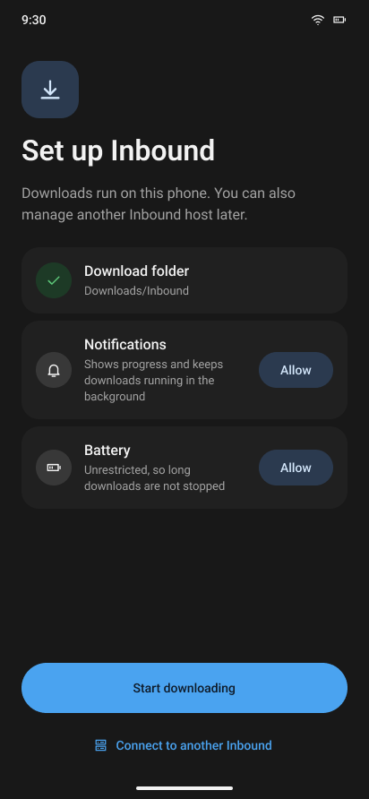 | 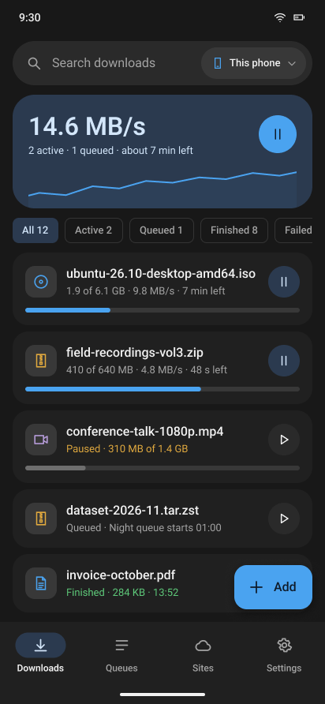 | 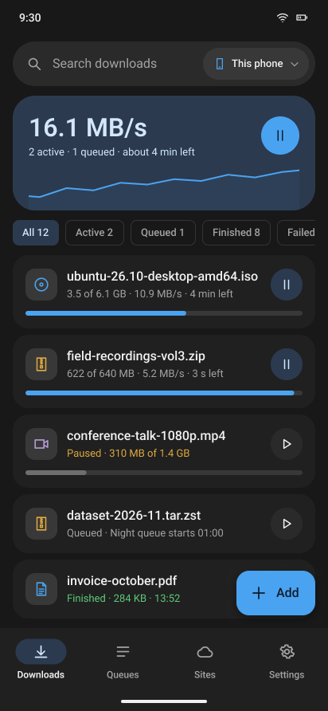 | 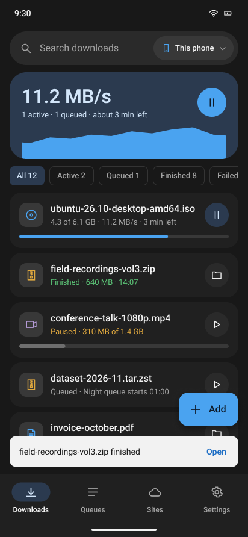 |

| A4 Add | A5 New download | A6 Details | A7 In the background |
| --- | --- | --- | --- |
| 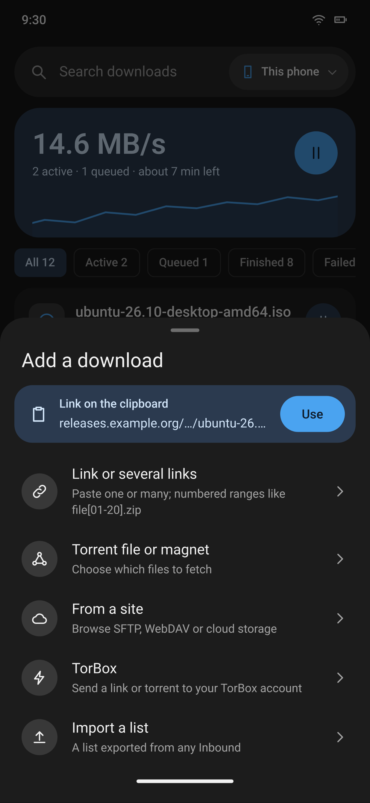 | 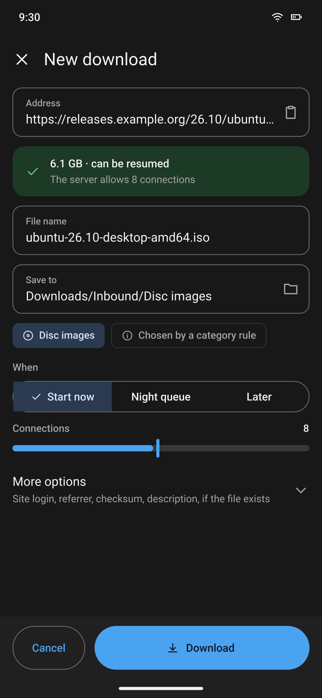 | 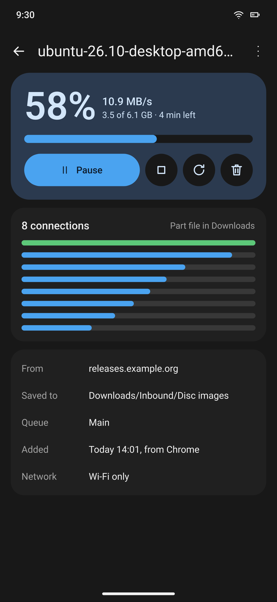 | 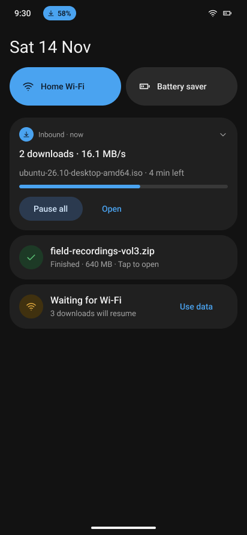 |

### B. Catching links

| B1 Share to Inbound | B2 Caught | B3 Signed-in downloads | B4 All links on a page | B5 Select several | B6 Expired link |
| --- | --- | --- | --- | --- | --- |
| 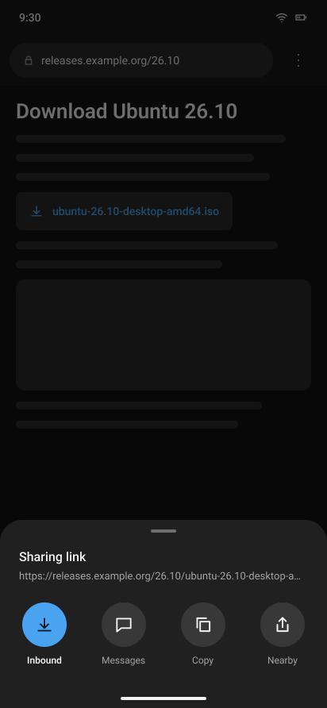 | 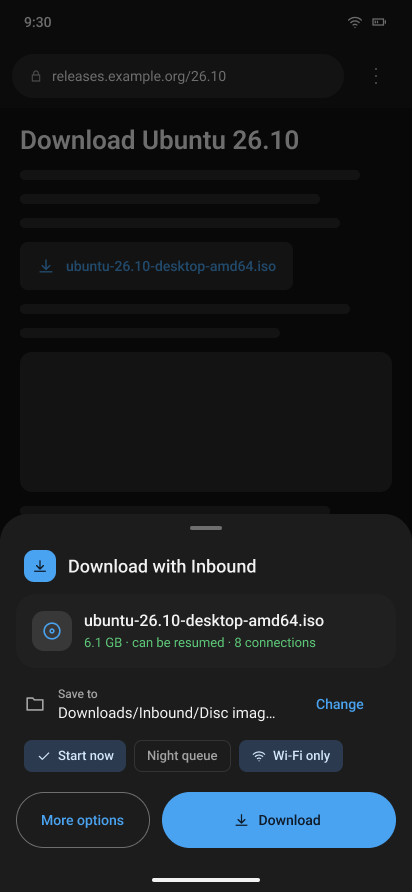 | 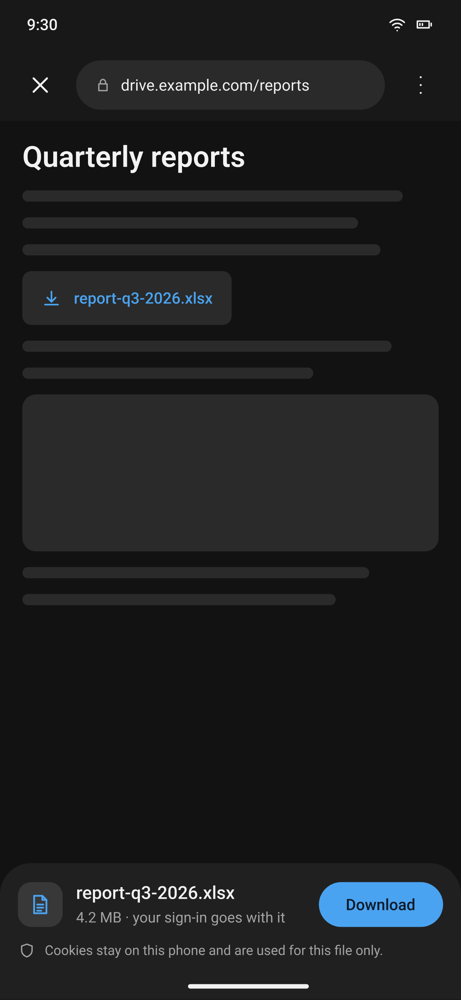 | 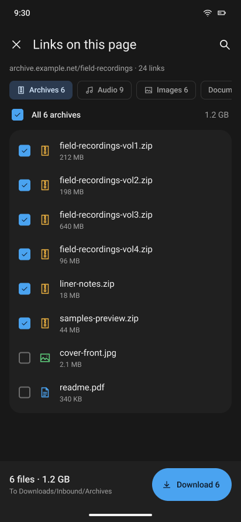 | 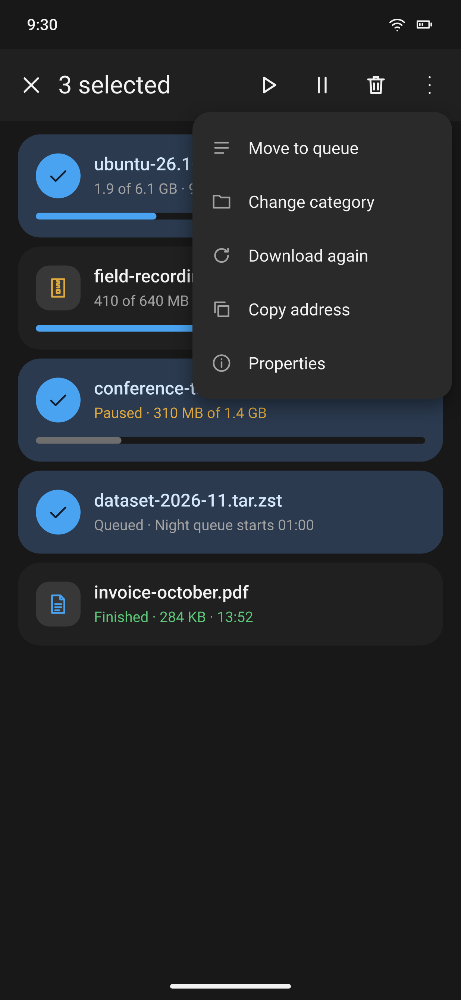 | 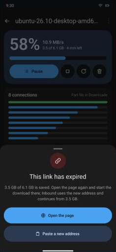 |

### C. Queues, sites, hosts and settings

| C1 Queues | C2 Schedule | C3 Sites | C4 Browse a site |
| --- | --- | --- | --- |
| 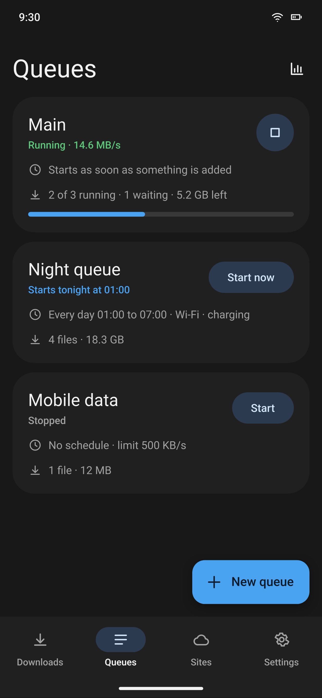 | 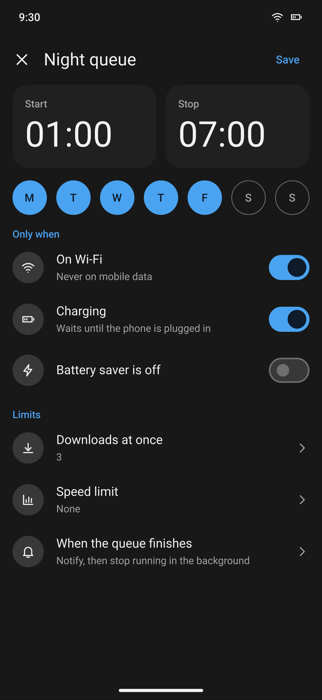 | 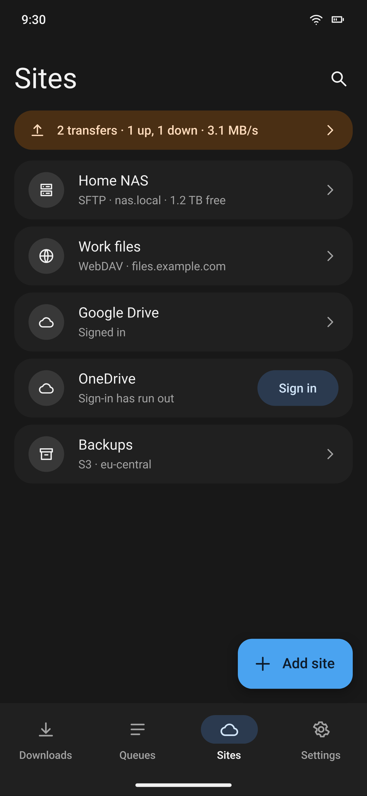 | 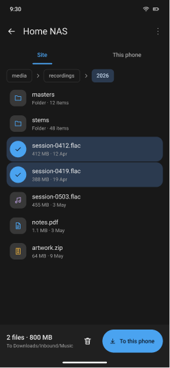 |

| C5 Switch host | C6 Managing another host | C7 Settings | C8 Light theme |
| --- | --- | --- | --- |
| 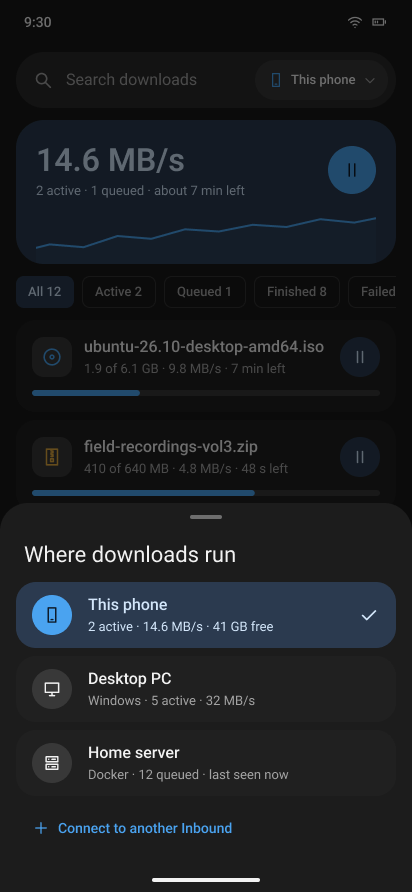 | 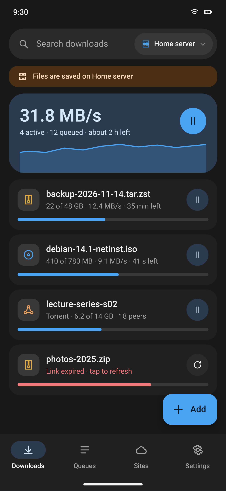 | 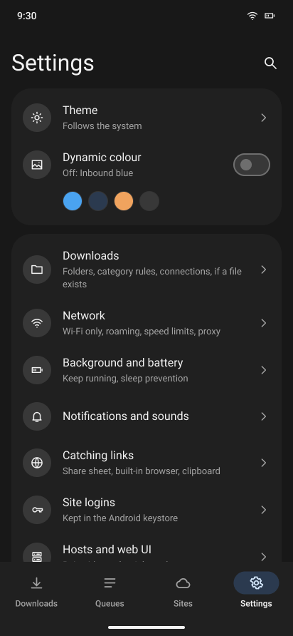 | 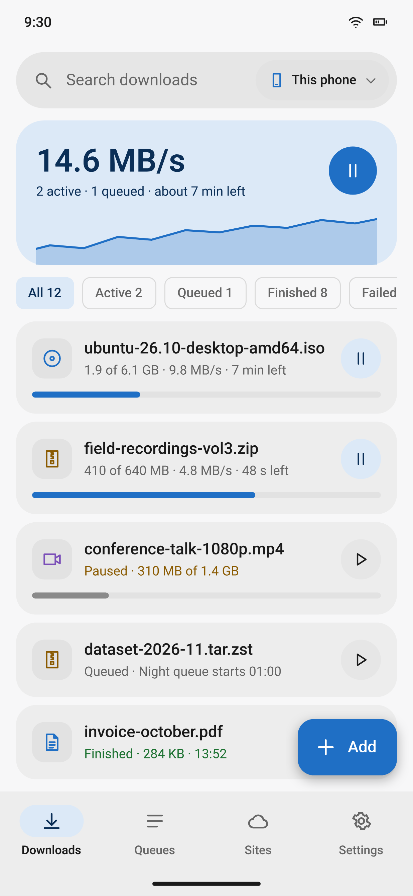 |

### How it works (overview of the Figma board)

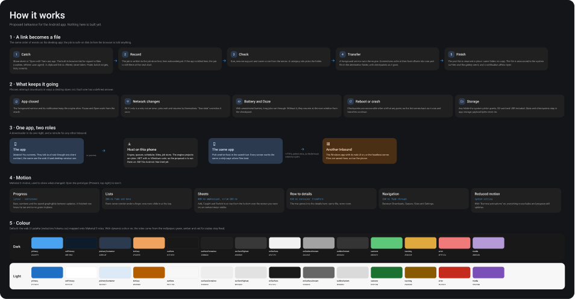

Its content is sections 3, 4 and 7 of this plan.

### Known faults in the mockup

- B4: the "Archives" filter is on, but the list also shows an image and a PDF.
- B1's note says long-pressing a link and choosing "Open with" works like Share. That is not checked; Android 12 and
  later limit which apps may open ordinary web links (section 6).
- Row to details is a plain slide in the prototype; the motion spec asks for a container transform.
- Only the status bar, navigation bar and gesture bar are Figma components. Rows, cards and sheets are plain frames.
- Light theme has one screen. The free Figma plan allows one variable mode, so dark and light are two collections.

## 3. What the app does

One app, two roles.

1. **Host on this phone.** The same pipeline as the desktop: catch, record the job durably, check the address,
   transfer with several connections into one part file in the destination folder, rename in place, notify.
2. **Remote for another Inbound.** The host switcher in the search bar points every screen at the Windows app (with
   its web UI on) or a headless server. Files are then saved there. A strip on the screen says so.

Desktop features and where they are on the phone:

| Desktop | Phone |
| --- | --- |
| Download list, state views, search, multiselect | Downloads (A1, B5), filter chips for the state views |
| Add URL with file-info check, batch and numbered URLs, import list | Add sheet (A4), New download (A5) |
| Browser extension handoff | Share sheet (B1, B2) and the built-in browser tab (B3) |
| Download All | All links on a page (B4) |
| Progress window, segment map, speed graph | Details (A6), summary card on Downloads |
| Tray, completion dialog and sound | Notifications (A7), snackbar (A3) |
| Queues and Scheduler | Queues (C1), schedule editor (C2), with Wi-Fi and charging conditions added |
| Sites | Sites (C3), site browser with Site and This phone tabs (C4) |
| Managing another server | Host switcher (C5, C6) |
| Options | Settings (C7) |
| Expired-URL refresh | Expired link sheet (B6) |
| TorBox, torrents, archives | Entries in the Add sheet; screens not drawn yet |

Not on the phone: the native messaging host, the tray, Setup and its updater, shell integration, and Windows sleep
prevention. `docs/new-frontend-guide.md` section 3 is the checklist the app is held to; gaps are written down as
`partial`.

## 4. Architecture

- **Reused as they are (all `net10.0`, no Windows code):** `DownloadManager.Core`, `Contracts`, `Engine`,
  `Persistence`, `Runtime`. The commands are in the transport-free `Runtime/Ipc/HostCommandDispatcher`, so the app can
  call the host in process, with no pipe.
- **New: an Android host.** It implements `IHostPlatform` (`src/DownloadManager.Runtime/Ipc/IHostPlatform.cs`) for
  the phone: open a file, pick a folder, notifications, what the machine can do. It runs inside an Android service so
  downloads go on when the app's screen is closed. It stays the single writer of jobs, settings and checkpoints.
- **New: the app's screens.** They are a frontend in the sense of `docs/new-frontend-guide.md`: they show the host's
  state and send commands, and write nothing durable except their own view state. The same screens talk to a remote
  host over the server's existing API, as the web UI does.
- **The toolkit is native Android views with Material 3 components** (chosen after the trial, owner 2026-11-16). The
  screens' logic lives in a plain `net10.0` project (`DownloadManager.Mobile`) so it is unit-tested and reused for a
  remote host; the Android project holds the host, the service and the views. See the build plan, section 3.

## 5. The performance question (.NET or Rust)

**Answered (ANDROID.2, 2026-11-16): .NET stays, on NativeAOT.** The battery mark is met (better than Jelly on the
Mi 8 Lite, equal to Edge on the S24 FE); a native screen draws a 200-job list 0.8 s after a cold start on the S24 FE
(the default Mono build; the NativeAOT app does 0.21 to 0.23 s there, build plan step 1).
The measurements still owed are taken on the real app (build plan, section 6). The text below is the plan as written
before the trial.

The owner's rule: keep the .NET engine unless performance on a phone is a problem. So the first work item measures
it, on a real phone, before any screen is built.

Measure, for the .NET engine on Android with `tools/TestServer` and one real server:

- transfer rate against what the link can carry, with 1 and with 8 connections, on Wi-Fi;
- CPU use and battery drain over a long download (an hour or more), screen off;
- memory of the service while downloading and while idle;
- wake-ups and CPU while idle with nothing to do (the owner ranks idle cost above memory);
- time from tapping the icon to a usable list, and from boot to resumed downloads;
- size of the installed app.

Pass marks (confirmed by the owner, 2026-11-15):

- transfer rate within 10% of the link's capacity on a mid-range phone;
- no measurable CPU or wake-ups while idle;
- a usable list within 1 second of a warm start and 2 seconds of a cold one;
- no more battery drain per GB than the phone's own browser downloading the same file.

If a mark is missed, tune first (ahead-of-time compilation, trimming, buffer sizes). If it is still missed, port to
Rust. What a port would cover depends on what failed: if only the transfer loop is slow, `DownloadManager.Engine`
alone is rewritten behind its present interfaces and the file formats stay; if the .NET runtime itself is the cost
(start time, memory, idle), Runtime and Persistence go too, and that is a much larger job that needs its own plan.

## 6. Things Android does differently (to find out first)

Each of these can change the design. Point 1 was checked in the trial (by path, below); the others are not checked yet.

1. **Files by path.** `HttpDownloadEngine` opens the part file with `FileStream` and a path. A folder the user picks
   with the system picker is a content address, not a path. The rule that the part file lives in the destination
   folder and is renamed in place must hold. Find out: random-access writes and in-place rename through the picker's
   grant, or a path-based place (the shared Downloads folder) as the default with picked folders as a second step.
   This probably needs a small file-access interface in the engine.
   **Found on the emulator (2026-11-15, API 35):** by path, the shared Downloads folder works with no permission and
   no engine change, rename included. The app cannot overwrite a file there that it did not create. Picked folders
   are not tried yet. Evidence: PROGRESS "Android first trial (ANDROID.2)".
2. **How long a background service may run.** Recent Android versions limit data-sync foreground services to a few
   hours a day and offer a separate "user-initiated data transfer" job for long downloads. Read the current rules and
   choose; the mockup's note on A7 says "foreground service" and may need changing.
   **Read 2026-11-17 (official pages; the five load-bearing facts re-read by a second agent and confirmed):**
   - dataSync foreground service: for apps targeting API 35+ on Android 15+, 6 hours in 24 in total, then
     `onTimeout` and a few seconds to stop or the app crashes; the budget resets when the user brings the app to the
     foreground (developer.android.com/develop/background-work/services/fgs/timeout). No cap on API 31 to 34.
   - Apps targeting API 35+ may not start a dataSync service from `BOOT_COMPLETED` (about/versions/15/behavior-changes-15).
   - User-initiated data transfer (UIDT) jobs, API 34+: `RUN_USER_INITIATED_JOBS`; "must be scheduled while the
     application is visible to the user" (or under the background-activity-launch exemptions, such as a notification
     tap; boot is not one); a required network, e.g. not metered, and the job runs when it is met; no quota and no
     standby-bucket limits; a notification while it runs (background-tasks/uidt).
   - Not found on any page, to be tried on the phones: what a swipe from Recents does to a UIDT job; whether a
     persisted UIDT job runs after a reboot without the app; UIDT in Doze; exactly what force-stop cancels.
   - API 36 makes ordinary jobs that run beside a foreground service obey the job runtime quota (behavior-changes-16).
   - The A7 mockup's wording fits either mechanism: it shows the notifications, not the mechanism.
3. **Catching links.** Share works for any app. Whether "Open with" can be offered for ordinary web links needs
   checking (Android 12 and later restrict it). The clipboard can only be read while the app is in front, which
   matches the design: the link is offered when the Add sheet opens.
4. **Signed-in downloads.** The built-in browser tab is a system WebView. Check that its download event gives the
   address, cookies, referrer and user agent the desktop extension sends, and that sign-in pages of the common sites
   work in a WebView at all (some refuse it).
5. **Sites needs rclone.** Android does not let an app run a program it downloaded, so rclone cannot be fetched from
   Options as on the desktop. It would have to ship inside the app. Check that this works and what it adds in size.
6. **Reboot and battery.** Resume after a reboot from the checkpoints; behaviour with and without the "unrestricted"
   battery setting; what Doze does to a scheduled queue start.
7. **Phones are arm64.** arm64 is on hold elsewhere in this project, but the owner allowed it for the Android app's
   device work (2026-11-15). An emulator on x86-64 is still enough for early work.
8. **Torrents, TorBox, archives.** TorBox is an API and should carry over. The torrent engine and archive extraction
   depend on what those use on the desktop; check each for native parts.

## 7. Motion and colour (from the design)

- Progress: bars, numbers and the speed graph move continuously between updates; a finished row loses its bar and
  turns green in place.
- Lists: 200 ms fade and move; rows never reorder under a finger.
- Sheets (Add, Caught, Switch host): 400 ms with Material's emphasized easing, scrim 200 ms.
- Row to details: container transform, 450 ms.
- Navigation bar: 200 ms fade through.
- With the system's "Remove animations" on, everything cross-fades and progress still updates.
- Colour roles and their dark and light values are the Figma variables ("Inbound scheme", "Inbound scheme (Light)").
  With dynamic colour on, the roles come from the wallpaper; the green, amber and red of states stay fixed.

## 8. Order of work

Each item is done only with evidence linked in `PROGRESS.md`.

- **ANDROID.2 First trial and measurements.** The engine and Runtime running on Android (emulator first), one
  download end to end with resume after a kill. The measurements of section 5. Answers to section 6, points 1 and 2.
  A one-screen trial in each candidate toolkit. Ends with: .NET or Rust, the toolkit, the storage model.
- **ANDROID.3 Host on the phone.** The Android host and service: storage, notifications with Pause and Open, network
  rules (Wi-Fi only waits, it does not fail), reboot resume, battery behaviour.
- **ANDROID.4 Core screens (row A).** First run, Downloads, Add, New download, Details, multiselect, delete with the
  file choice. Both themes and dynamic colour.
- **ANDROID.5 Catching (row B).** Share target and the Caught sheet, the built-in browser tab, all links on a page,
  expired-link refresh.
- **ANDROID.6 Queues, scheduler and settings (C1, C2, C7).**
- **ANDROID.7 Other hosts (C5, C6).** Pairing, the host switcher, every screen against a remote host.
- **ANDROID.8 Sites (C3, C4),** if rclone can ship in the app.
- **ANDROID.9 TorBox, torrents, archives.** Screens still to be designed.
- **ANDROID.10 Release.** Signing, how the app is handed out and updated, third-party notices.

## 9. Open questions for the owner

1. ~~arm64: may device work start?~~ Answered 2026-11-15: yes, for the Android app.
2. ~~The pass marks in section 5.~~ Answered 2026-11-15: as proposed.
3. ~~The oldest Android version.~~ Answered 2026-11-15: Android 12, so dynamic colour is there on every supported
   phone.
4. ~~How the app is handed out.~~ Answered 2026-11-15: a signed APK on the releases page, with the app checking there
   for updates.

Nothing is waiting for the owner now.
